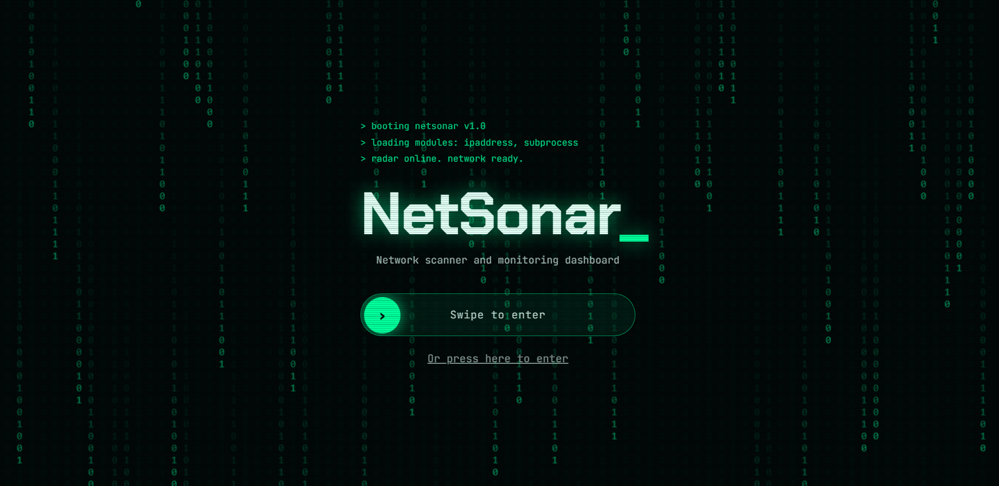
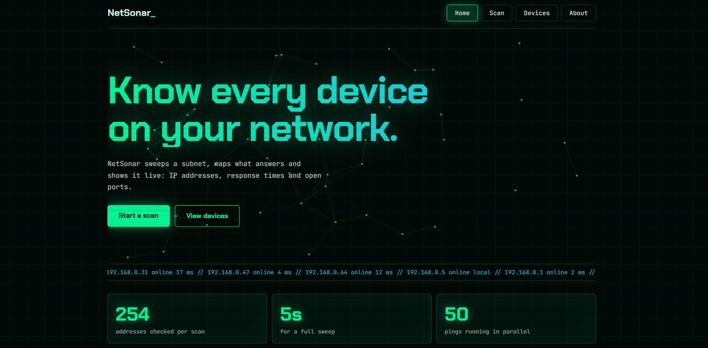
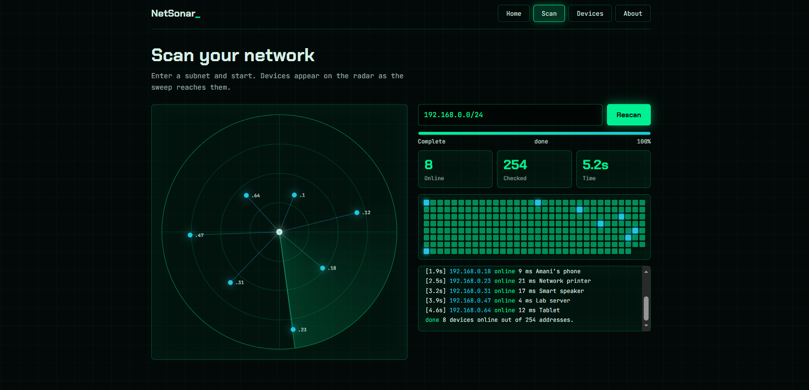
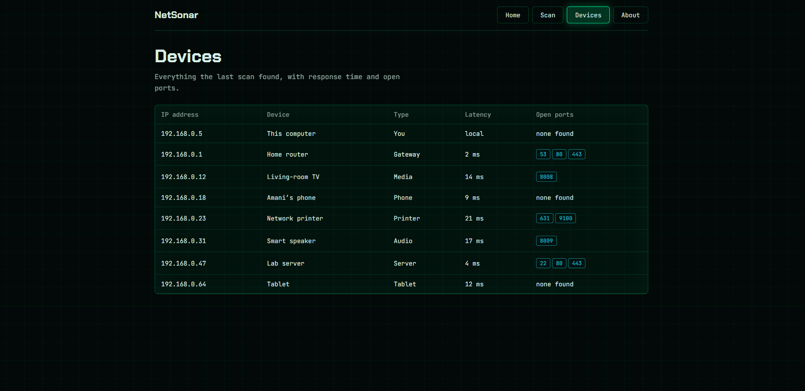

# NetSonar: Network Scanner and Dashboard

A Python project that started as an IPv4 subnet calculator and grew into a network scanner with a live web dashboard.

## Screenshots









## Features

**Dashboard**
- Animated entrance screen and a radar view that shows devices as they are found.
- Scan page with progress bar, address grid and live log.
- Devices page listing everything the last scan found.

**Scanner**
- Discovers online devices on a local subnet using threaded pings.
- Accepts private networks only, up to `/24`.

**IPv4 calculator** (`src/network_info.py`)
- Accepts an IPv4 address and a mask (`255.255.255.0`, `/24` or `24`).
- Calculates network address, broadcast address and usable hosts.
- Validates input and handles `/31` and `/32` networks.

## Technologies Used

- Python 3
- Flask (web server)
- `ipaddress`, `subprocess`, `socket` (standard library)
- HTML, CSS and JavaScript (dashboard)

## Project Structure

```text
technical-projects/
├── app.py
├── requirements.txt
├── README.md
├── src/
│   ├── network_info.py
│   └── scanner.py
└── static/
    └── index.html
```

## Installation

```bash
git clone https://github.com/amani-ghourabi/technical-projects.git
cd technical-projects
pip install -r requirements.txt
```

## Usage

**Dashboard**

```bash
python app.py
```

Then open `http://127.0.0.1:5000` in your browser, swipe to enter, and press **Scan**. Enter your own network in the box, for example `192.168.1.0/24`. You can find it with `ipconfig` (Windows) or `ip a` (Linux/macOS).

**IPv4 calculator**

```bash
python src/network_info.py
```

## Example

```text
$ netsonar scan 192.168.0.0/24
192.168.0.5  online  This computer
192.168.0.1  online  Router (gateway)
192.168.0.12 online  Device 12
done 3 devices online out of 254 addresses.
```

## Responsible Use

This project is for learning. Scan only networks you own or have permission to test. The scanner refuses public IP ranges on purpose.

## Learning Objectives

- IPv4 addressing, subnet masks and CIDR notation
- Network and broadcast addresses
- Python functions, modules and error handling
- Threads and subprocesses
- Building a Flask backend and a JavaScript frontend
- Git and GitHub workflow

## Author

**Amani Ghourabi**

GitHub: [amani-ghourabi](https://github.com/amani-ghourabi)